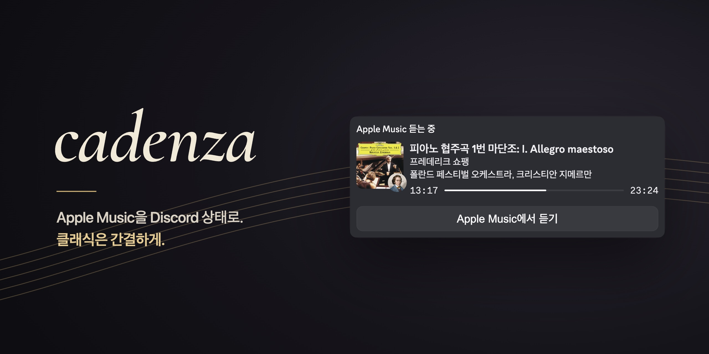
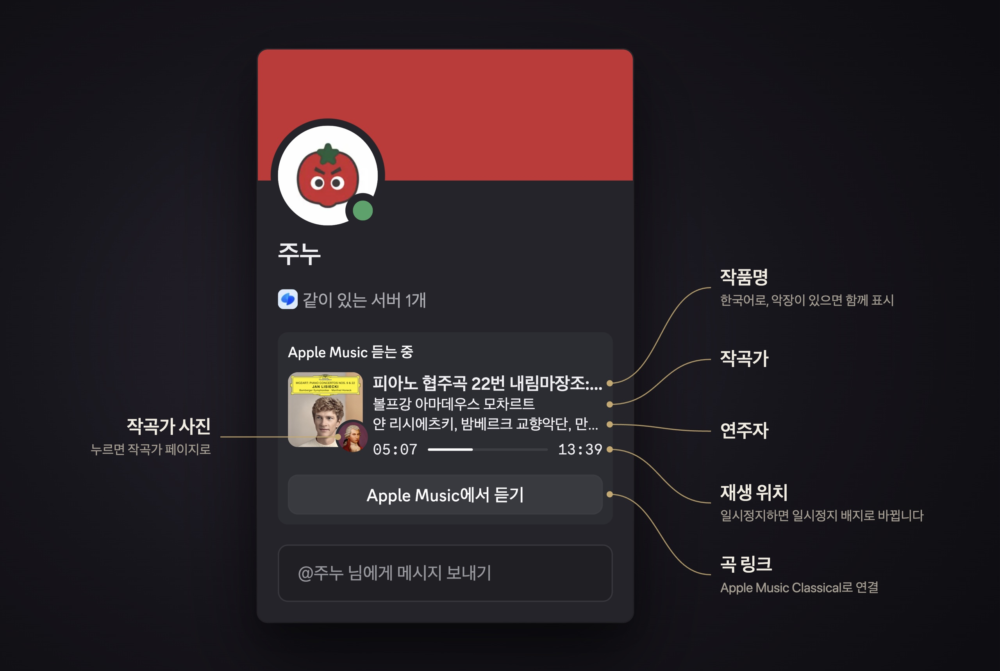

# cadenza

[](https://github.com/AndyH0ng/cadenza/actions/workflows/test.yml)
[](https://github.com/AndyH0ng/cadenza/releases)
[](LICENSE)


macOS Apple Music에서 재생 중인 곡을 Discord "듣는 중" 상태로 보여줍니다.  
Apple Music Classical 카탈로그에 있는 곡은 작품명, 작곡가, 연주자를 한국어로 표시합니다.


## 설치

macOS, Music 앱, Discord 데스크톱 앱이 필요합니다.

### 릴리스

[Releases](https://github.com/AndyH0ng/cadenza/releases)에서 `cadenza-<버전>-macos.zip`을 받아 압축을 풉니다. 바이너리와 adapter가 함께 들어 있으므로 폴더 구조를 유지하세요. Apple 공증을 받지 않은 바이너리라서 처음 한 번 격리 속성을 지워야 합니다.

```sh
xattr -dr com.apple.quarantine cadenza-<버전>-macos
```

### 소스에서 빌드

Go, CMake, Xcode Command Line Tools가 필요합니다. 버전은 [`mise.toml`](mise.toml)에 있습니다. Now Playing은 서브모듈로 들어 있는 [mediaremote-adapter](https://github.com/ungive/mediaremote-adapter)로 읽습니다.

```sh
git clone --recurse-submodules https://github.com/AndyH0ng/cadenza.git
cd cadenza
mise install
cmake -S third_party/mediaremote-adapter -B third_party/mediaremote-adapter/build
cmake --build third_party/mediaremote-adapter/build
go build ./cmd/cadenza
```

## 설정

1. [Discord Developer Portal](https://discord.com/developers/applications)에서 애플리케이션을 만듭니다. 애플리케이션 이름이 프로필 카드 제목이 됩니다.
2. **Rich Presence → Art Assets**에 [`assets/paused.png`](assets/paused.png)를 `paused`라는 이름으로 올립니다. cadenza가 이 이미지를 일시정지 배지로 씁니다.

## 실행

```sh
DISCORD_CLIENT_ID=<Application ID> ./cadenza
```

| 옵션 | 환경 변수 | 기본값 | 설명 |
|---|---|---|---|
| `-client-id` | `DISCORD_CLIENT_ID` | | Discord 애플리케이션 ID (필수) |
| `-country` | `CADENZA_COUNTRY` | `kr` | Apple Music 스토어프론트 |
| `-language` | `CADENZA_LANGUAGE` | `ko-KR` | 메타데이터 언어 |
| `-adapter` | `CADENZA_ADAPTER` | 바이너리 옆 `third_party/mediaremote-adapter` | 빌드한 adapter 경로 |
| `-clear-paused` | | 꺼짐 | 일시정지 중에는 상태를 지웁니다 |

표시 형식(`{work}`, `{composer}` 같은 플레이스홀더)과 전송 간격은 [`presence.DefaultConfig`](internal/presence/presence.go)와 [`app.DefaultConfig`](internal/app/app.go)에서 바꿉니다.

### 로그인 시 자동 실행

`~/Documents`, `~/Desktop`, `~/Downloads` 밖에 설치하세요. macOS가 이 폴더들을 보호해서 launchd의 실행을 막을 수 있습니다. 아래는 `~/.local/lib/cadenza`에 설치한 경우입니다. `~/Library/LaunchAgents/io.github.andyh0ng.cadenza.plist`:

```xml
<?xml version="1.0" encoding="UTF-8"?>
<!DOCTYPE plist PUBLIC "-//Apple//DTD PLIST 1.0//EN" "http://www.apple.com/DTDs/PropertyList-1.0.dtd">
<plist version="1.0">
<dict>
	<key>Label</key>
	<string>io.github.andyh0ng.cadenza</string>
	<key>ProgramArguments</key>
	<array>
		<string>/Users/<사용자>/.local/lib/cadenza/cadenza</string>
	</array>
	<key>EnvironmentVariables</key>
	<dict>
		<key>DISCORD_CLIENT_ID</key>
		<string><Application ID></string>
	</dict>
	<key>RunAtLoad</key>
	<true/>
	<key>KeepAlive</key>
	<true/>
	<key>StandardOutPath</key>
	<string>/Users/<사용자>/Library/Logs/cadenza.log</string>
	<key>StandardErrorPath</key>
	<string>/Users/<사용자>/Library/Logs/cadenza.log</string>
</dict>
</plist>
```

```sh
launchctl bootstrap gui/$(id -u) ~/Library/LaunchAgents/io.github.andyh0ng.cadenza.plist   # 시작
launchctl bootout gui/$(id -u)/io.github.andyh0ng.cadenza                                  # 중지
```

## 동작

### 클래식 곡



### 그 밖의 곡


### 세부 동작

- 재생 중에는 진행 바와 인물 사진 배지를 표시합니다. 클래식 곡은 작곡가, 그 밖의 곡은 가수 사진입니다.
- 일시정지 중에는 진행 바 대신 일시정지 배지를 표시합니다. Discord는 20초에 5번 정도만 업데이트를 받기 때문에 상태는 4초 간격으로 보냅니다. 그보다 짧은 일시정지는 표시하지 않습니다. 곡을 빠르게 넘기면 macOS가 재생 재개를 놓칠 때가 있어서, 일시정지 후 30초 동안은 Music에 직접 상태를 확인합니다.
- 카드 아래에 Apple Music Classical 또는 Apple Music 링크 버튼을 붙입니다. Discord는 이 버튼을 본인에게 보여주지 않습니다.
- 브라우저 영상처럼 다른 앱이 Now Playing을 가져가면 AppleScript로 Music 상태를 직접 확인합니다. 처음 실행하면 macOS가 Music 제어 권한을 묻습니다. 거부하면 그동안은 상태를 지웁니다. 권한은 **시스템 설정 → 개인정보 보호 및 보안 → 자동화**에서 바꿀 수 있습니다.
- Apple API 조회가 1.5초 안에 끝나지 않으면 Now Playing 정보로 먼저 표시하고, 조회가 끝나면 바꿉니다. 조회가 실패하면 1분마다 다시 시도합니다.
- Discord를 다시 시작하면 다시 연결해 상태를 복원합니다.

## 주의

한국어 메타데이터는 Apple Music Classical 웹 플레이어의 비공개 API에서 가져옵니다. Apple이 API를 바꾸면 한국어 정보 없이 Now Playing 정보로만 표시하고, 로그에 `Apple API changed` 오류를 남깁니다. 이 오류가 보이면 이슈로 알려 주세요.

## 개발

테스트, 코드 구조, 릴리스 방법은 [CONTRIBUTING.md](CONTRIBUTING.md)를 보세요.

## 라이선스

[MIT](LICENSE). 함께 들어 있는 [mediaremote-adapter](third_party/mediaremote-adapter)는 BSD 3-Clause 라이선스입니다.

This project is not affiliated with Apple or Discord.
